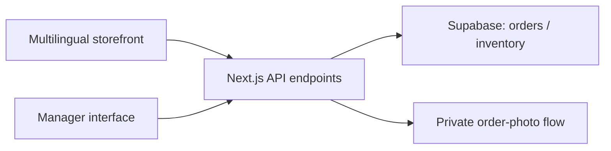

# Cherry on Top — Multilingual Commerce Website

**Project type:** Commercial website and backend integration  
**Industry:** Desserts and custom cakes  
**Status:** Completed commercial client delivery  
**Role:** Website development, business-process integration, and deployment preparation

## Business challenge

A dessert business needed a customer-facing catalog and ordering experience alongside tools for handling incoming orders, product availability, and custom-cake requests.

## Solution

Built a multilingual commerce website with a product catalog, shopping cart, order requests, custom-cake photo handling, and a manager-facing order and inventory interface.

The repository confirms a **HTML/CSS/JavaScript storefront** with **Next.js/TypeScript server routes** and **Supabase** integration. The deployment configuration targets **Vercel**. The entire storefront should not be described as a React UI: the main customer interface is implemented as static frontend assets.

## Key capabilities

- Responsive catalog with Azerbaijani, Russian, and English language support.
- Product browsing, shopping cart, and order submission.
- Custom-cake requests with private reference-photo handling.
- Order-status checking.
- Manager-protected order and inventory endpoints.
- Supabase-backed order and inventory operations.
- Abuse-prevention measures: request rate limits, security headers, and optional bot verification.
- Automated repository checks for selected business and security behaviors.

## Technology stack

| Area | Technology |
| --- | --- |
| Storefront | HTML, CSS, JavaScript |
| Backend | Next.js 16 API routes, TypeScript 5 |
| Data and authentication | Supabase |
| Hosting configuration | Vercel |
| Runtime/tooling | Node.js, npm, ESLint, Node test runner |

*Versions reflect the inspected GitHub package manifest in October 2026 and may change with subsequent releases.*

## High-level architecture

*Simplified architecture for portfolio purposes.*

## Deliverables

- Customer-facing product and ordering experience.
- Protected operations flows for managers.
- Server routes for orders, order statuses, inventory, and custom requests.
- Deployment and configuration documentation.

## Scope clarification

This case study does not claim an integrated online-payment gateway, a measurable revenue increase, or any unverified traffic/conversion result. A public live-site URL and screenshots should be included only after checking availability and publication permission.

## Confidentiality

The production repository remains private. No source code, customer records, credentials, deployment secrets, or proprietary brand assets are distributed with this case study.
