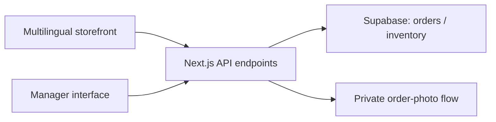

# Cherry on Top — Multilingual Commerce Website

**View the website:** [cherryontopbaku.az](https://cherryontopbaku.az)  
**Project type:** Commercial website and backend integration  
**Industry:** Desserts and custom cakes  
**Status:** Completed commercial client delivery  
**Role:** AI-assisted website creation and delivery; integration and deployment preparation

## Business challenge

A dessert business needed a customer-facing catalog and ordering experience alongside tools for handling incoming orders, product availability, and custom-cake requests.

## Solution

Created a multilingual commerce website with AI-assisted code generation and iteration. The resulting solution includes a product catalog, shopping cart, order requests, custom-cake photo handling, and a manager-facing order and inventory interface.

The repository confirms a **HTML/CSS/JavaScript storefront** with **Next.js/TypeScript server routes** and **Supabase** integration. The deployment configuration targets **Vercel**. The entire storefront should not be described as a React UI: the main customer interface is implemented as static frontend assets.

## Screenshots

Real screenshots captured from the Cherry on Top storefront (October 2026). No mockups or stock images.

### Homepage

### Dietary desserts category

### Product details

**Live website:** [cherryontopbaku.az](https://cherryontopbaku.az)

## Key capabilities

- Responsive catalog with Azerbaijani, Russian, and English language support.
- Product browsing, shopping cart, and order submission.
- Custom-cake requests with private reference-photo handling.
- Order-status checking.
- Manager-protected order and inventory endpoints.
- Supabase-backed order and inventory operations.
- Abuse-prevention measures: request rate limits, security headers, and optional bot verification.
- Automated repository checks for selected business and security behaviors.

## Development approach

This was an **AI-assisted development project**. I used AI tools to help create the website rather than writing all of its JavaScript and TypeScript code independently. The technologies below describe the implemented product and should not be interpreted as a list of programming languages I claim to know professionally.

## Technology stack

| Area | Technology |
| --- | --- |
| Storefront | HTML, CSS, JavaScript |
| Backend | Next.js 16 API routes, TypeScript 5 |
| Data and authentication | Supabase |
| Hosting configuration | Vercel |
| Runtime/tooling | Node.js, npm, ESLint, Node test runner |

*Versions reflect the inspected GitHub package manifest in October 2026 and may change with subsequent releases.*

## High-level architecture

*Simplified architecture for portfolio purposes.*

## Deliverables

- Customer-facing product and ordering experience.
- Protected operations flows for managers.
- Server routes for orders, order statuses, inventory, and custom requests.
- Deployment and configuration documentation.

## Scope clarification

This case study does not claim an integrated online-payment gateway, a measurable revenue increase, or any unverified traffic/conversion result. The project website was provided by the project creator, who confirms that it is accessible. Portfolio screenshots can be added after reviewing them for privacy and client publication permission.

## Confidentiality

The production repository remains private. No source code, customer records, credentials, deployment secrets, or proprietary brand assets are distributed with this case study.
