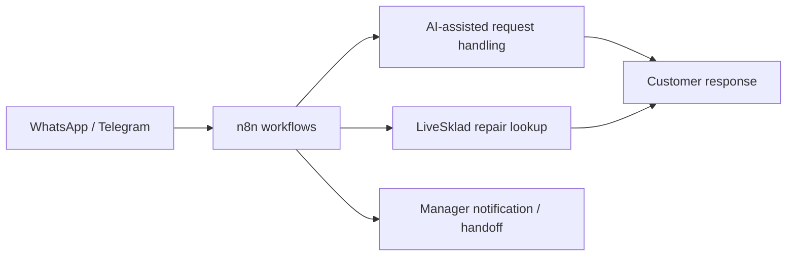

# TEZ-TEZ — AI Customer Service Automation

**Project type:** Commercial AI automation and business integration  
**Industry:** Repair and equipment rental  
**Status:** Working project prepared for client handover (October 2026)  
**Role:** Workflow development, integration, testing, and handover preparation

## Business challenge

Customer questions arrive through different messaging channels. Employees need a consistent way to respond to inquiries, check repair statuses, process service and rental requests, and receive cases that require human attention.

## Solution

Developed AI-assisted customer-service workflows for **WhatsApp and Telegram**, orchestrated through **n8n**.

The solution connects messaging channels with OpenAI-assisted response handling and **LiveSklad** repair-status data. Cases that need human follow-up are routed to a manager through Telegram notifications.

## Key capabilities

- Processes incoming customer messages and supported attachments.
- Handles repair-status questions using the LiveSklad integration.
- Supports repair and rental inquiry flows.
- Routes appropriate customer requests for manager follow-up.
- Uses n8n to coordinate message-handling and integration steps.
- Runs on DigitalOcean-hosted automation infrastructure, as documented in project handover materials.

## Technology stack

| Area | Technology |
| --- | --- |
| Workflow orchestration | n8n |
| AI integration | OpenAI API |
| Messaging | WhatsApp, Telegram |
| Business system | LiveSklad |
| Infrastructure | DigitalOcean |

## High-level architecture

*Simplified architecture for portfolio purposes; this is not a production configuration diagram.*

## Outcome and project stage

The project reached the working/handover-preparation stage with documented versions of its messaging workflows and an operations handover checklist. No numeric performance gains are claimed because verified production metrics are not available for publication.

## Privacy and availability

The original n8n workflow exports, infrastructure addresses, access credentials, customer identifiers, and operational logs remain private. A sanitized walkthrough can be prepared separately if the customer authorizes it.
